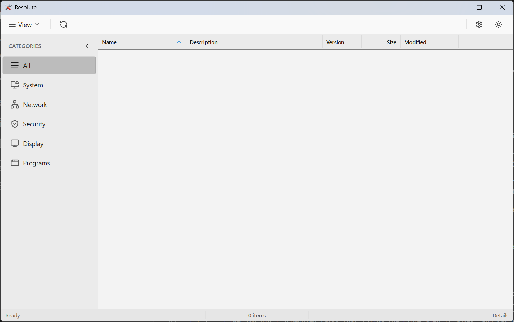
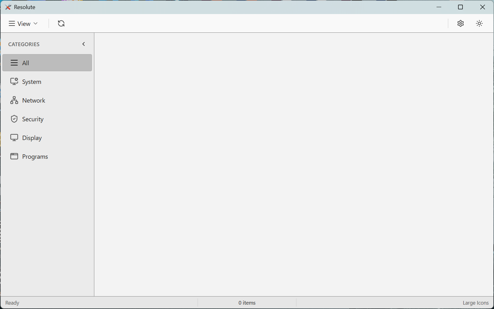
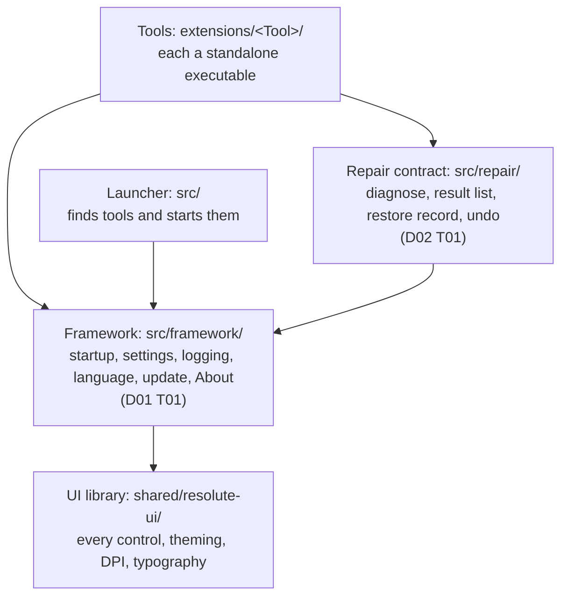

<div align="center">

<picture>
  <source media="(prefers-color-scheme: dark)" srcset="resources/logos/rizonesoft-logo-light.svg">
  
</picture>

# Resolute

**Windows repair and system tools that fix the problem, show what they changed, and can put it back.**

[](https://github.com/rizonesoft/Resolute/actions/workflows/gates.yml) [](https://github.com/rizonesoft/Resolute/actions/workflows/plan.yml)   

</div>

Resolute is Rizonesoft's suite of Windows system utilities: a launcher and a set of repair and maintenance tools, each of which also ships on its own. It is being rewritten in C++ from a mature AutoIt suite that still ships, so that every tool shares one framework, scales to any display, follows the system's light or dark theme, and records what it changes so it can undo it.

<details>
<summary><b>Contents</b></summary>

- [Who is it for?](#who-is-it-for)
- [What does it look like?](#what-does-it-look-like)
- [Quick start](#quick-start)
- [Configuration](#configuration)
- [Usage](#usage)
- [The tools](#the-tools)
- [How far along is it?](#how-far-along-is-it)
- [How is it built?](#how-is-it-built)
- [Troubleshooting](#troubleshooting)
- [Docs and contributing](#docs-and-contributing)
- [Support and security](#support-and-security)
- [Status and license](#status-and-license)

</details>

## Who is it for?

People who look after Windows machines, their own or other people's, and want a tool that fixes a broken network stack, a drive Windows no longer sees or a file they cannot open, without guessing what it did. And contributors who want to build Windows tools in modern C++ against one shared framework rather than fourteen copies of one.

## What does it look like?

The launcher, built from this repository and captured with its provenance (what was captured, from which build, on which machine): [details view](docs/captures/2026-11-13-D00-T05-s1-launcher-details-light.txt) and [large icons](docs/captures/2026-11-13-D00-T05-s1-launcher-large-icons-light.txt).

<picture>
  <source media="(prefers-color-scheme: dark)" srcset="docs/captures/2026-11-13-D00-T05-s1-launcher-details-dark.png">
  
</picture>

<picture>
  <source media="(prefers-color-scheme: dark)" srcset="docs/captures/2026-11-13-D00-T05-s1-launcher-large-icons-dark.png">
  
</picture>

## Quick start

On Windows 10 or 11 x64 with Git and PowerShell 7, from an empty folder:

```powershell
git clone https://github.com/rizonesoft/Resolute.git
cd Resolute
pwsh scripts/bootstrap.ps1     # downloads the pinned llvm-mingw, CMake, Ninja, Python and sccache into reskit/, hash-checked
pwsh scripts/build.ps1 -All    # builds the launcher and every C++ tool, Release
pwsh scripts/check-all.ps1     # runs every gate: build, clang-tidy, tests, plan and document checks
```

Nothing is installed system-wide and no Visual Studio is needed: llvm-mingw carries its own headers and import libraries. `check-all` prints one line per gate and ends with its verdict, `check-all: <n> gate(s) ok` when every gate passed.

## Configuration

Every setting is a script parameter; there is no configuration file to write.

| Setting | Default | What it does |
| --- | --- | --- |
| `bootstrap.ps1 -Force` | off | Downloads every pinned component again, even one already present |
| `bootstrap.ps1 -Replace` | off | Replaces a component whose installed version differs from its pin |
| `build.ps1 <Name>` | none | Builds one target: `Resolute` (the launcher) or any folder under `extensions/` |
| `build.ps1 -All` | none | Builds the launcher and every tool |
| `build.ps1 -Config` | `Release` | `Debug` or `Release` |
| `check-all.ps1 -SkipBuild` | off | Skips the build and tidy gates, for a change to documents only |

The pinned versions and their hashes live in [`toolchain.json`](toolchain.json); a download whose hash differs is refused.

## Usage

`build.ps1` puts the launcher at `Bin\Release\Resolute.exe` (`Bin\Debug\` for a Debug build) and each tool in `Bin\Release\System\`. Start the launcher:

```powershell
.\Bin\Release\Resolute.exe
```

The launcher lists every executable in its `System\` folder that describes itself with an embedded `RESEXT` resource ([`docs/extensions.md`](docs/extensions.md)): no install step, no registry, no configuration file. Today its list is empty: `build.ps1 -All` puts `RegStudio`, the first tool built in C++, in `System\`, but RegStudio does not declare itself yet (`D05 T02 §1` adds that), and the AutoIt tools ship from the AutoIt suite until their ports land. Each tool also runs on its own, without the launcher: `.\Bin\Release\System\RegStudio.exe`, which asks for administrator rights because it edits the registry.

## The tools

<!-- tool-gallery:begin -->
<!-- generated by scripts/readme-blocks.py; edit docs/readme/tools.json or the plan, never this block -->
| | Tool | What it does | Today | C++ |
| :-: | --- | --- | --- | --- |
|  | **Ownership** (frozen) | Take ownership of files, folders and registry keys from the context menu. | AutoIt, shipping | planned ([TODO-02-ownership-complete](todo/04-tools-port/TODO-02-ownership-complete.md)) |
|  | **ComIntRep** (frozen) | Repair Windows internet and network connectivity in one pass: Winsock, IP, proxy and more. | AutoIt, shipping | planned ([TODO-03-comintrep-complete](todo/04-tools-port/TODO-03-comintrep-complete.md)) |
|  | **PixRepair** (frozen) | Exercise stuck LCD pixels with rapidly changing colour patterns. | AutoIt, shipping | planned ([TODO-04-pixrepair-complete](todo/04-tools-port/TODO-04-pixrepair-complete.md)) |
|  | **BiosCodes** (frozen) | Look up what a BIOS beep code means, by manufacturer. | AutoIt, shipping | planned ([TODO-05-bioscodes-complete](todo/04-tools-port/TODO-05-bioscodes-complete.md)) |
|  | **USBRepair** (frozen) | Repair USB devices and drives that Windows no longer recognises. | AutoIt, shipping | planned ([D04 T01 §4](todo/implementation-plan.md)); folds into Drive Repair ([decision](docs/brainstorm/2026-09-16-completion-brainstorm.md#product-count-after-decisions-6-and-11)) |
|  | **DVDRepair** (frozen) | Repair CD and DVD drives that Windows no longer shows. | AutoIt, shipping | planned ([D04 T01 §4](todo/implementation-plan.md)); folds into Drive Repair ([decision](docs/brainstorm/2026-09-16-completion-brainstorm.md#product-count-after-decisions-6-and-11)) |
|  | **MemBoost** | Free physical memory by trimming the working sets of running processes. | AutoIt, shipping | planned ([TODO-06-memboost-complete](todo/04-tools-port/TODO-06-memboost-complete.md)) |
|  | **Firemin** | Keep Firefox's memory use in check while it runs. | AutoIt, shipping | planned ([D04 T01 §3](todo/implementation-plan.md)); folds into the browser optimizer ([decision](docs/brainstorm/2026-09-16-completion-brainstorm.md#product-count-after-decisions-6-and-11)) |
|  | **Chromin** | Keep Chrome's memory use in check while it runs. | AutoIt, shipping | planned ([D04 T01 §3](todo/implementation-plan.md)); folds into the browser optimizer ([decision](docs/brainstorm/2026-09-16-completion-brainstorm.md#product-count-after-decisions-6-and-11)) |
|  | **Edgemin** | Keep Microsoft Edge's memory use in check while it runs. | AutoIt, shipping | planned ([D04 T01 §3](todo/implementation-plan.md)); folds into the browser optimizer ([decision](docs/brainstorm/2026-09-16-completion-brainstorm.md#product-count-after-decisions-6-and-11)) |
|  | **Watermin** | Keep Waterfox's memory use in check while it runs. | AutoIt, shipping | planned ([D04 T01 §3](todo/implementation-plan.md)); folds into the browser optimizer ([decision](docs/brainstorm/2026-09-16-completion-brainstorm.md#product-count-after-decisions-6-and-11)) |
|  | **RegStudio** | Browse, search and edit the Windows registry, with every change reversible. | new, C++ only | planned ([TODO-02-regstudio](todo/05-new-tools/TODO-02-regstudio.md)) |

Frozen tools change a system in ways that are hard to undo, so their C++ ports reproduce the AutoIt effect exactly, proven by a parity check.
<!-- tool-gallery:end -->

## How far along is it?

<!-- plan-progress:begin -->
<!-- generated by scripts/readme-blocks.py; edit docs/readme/tools.json or the plan, never this block -->
**89 of 249 sections done** (35 percent), read from [the plan](todo/implementation-plan.md).

| Phase | Done | Of |
| --- | :-: | :-: |
| 0. Gates, proof, and the bar | 87 | 99 |
| 1. The two shared layers | 2 | 33 |
| 2. The launcher and the ports | 0 | 47 |
| 3. Intake and new capability | 0 | 46 |
| 4. Ship it, in every language | 0 | 24 |

Next to run: phase 0, Gates, proof, and the bar.
<!-- plan-progress:end -->

The plan is the contract: every section is built, proven by a check from a real run, reviewed independently and only then marked done. [`todo/README.md`](todo/README.md) explains how to read it.

## How is it built?

Every tool consumes two shared layers, and the one rule between them is that a tool never reimplements what a layer below it provides.



The repair contract is for the repair tools only. The framework and the repair contract are planned in [`D01 T01`](todo/01-framework/TODO-01-framework-core.md) and [`D02 T01`](todo/02-repair-contract/TODO-01-repair-contract.md); the UI library and the launcher exist today.

<details>
<summary><b>Repository layout</b></summary>

| Path | What is there |
| --- | --- |
| `src/` | The launcher shell, and nothing else |
| `shared/resolute-ui/` | The Direct2D UI library every tool draws with |
| `shared/lucide/` | The icon set, linked into each executable |
| `extensions/` | The tools, each building as its own standalone executable |
| `tests/` | The Catch2 suites, fixtures and the parity driver |
| `reskit/` | The downloaded toolchain (ignored) and its environment helpers |
| `scripts/` | Bootstrap, build, the gates and the plan tooling |
| `resources/` | Application icons and the Rizonesoft logos |
| `resolute_au3/` | The AutoIt suite: frozen, and the specification the port is measured against |
| `todo/` | The plan; [`todo/implementation-plan.md`](todo/implementation-plan.md) is the generated view |
| `docs/` | Captures, reviews, run records and design notes |

</details>

<details>
<summary><b>What the gates check</b></summary>

`scripts/check-all.ps1` runs them all, and the `gates` workflow runs it on every push: the Debug and Release builds with warnings as errors, a clang-tidy ratchet that only goes down, the Catch2 suites in both configurations, the plan's structure and the claims it makes about this tree, the review wiring, and this README's generated blocks and links.

</details>

## Troubleshooting

| What you see | Why, and what to do |
| --- | --- |
| `pwsh` is not recognised | The scripts need PowerShell 7. Install it from Microsoft and run them from `pwsh`, not Windows PowerShell 5. |
| bootstrap refuses a download because its hash differs | The file is not the one pinned in `toolchain.json`. Nothing was installed; retry, and if it persists the mirror changed and the pin needs review. |
| CMake complains that the build tree was made at another path | `build.ps1` removes and rebuilds a tree another clone made; run it again rather than `cmake` by hand. |
| the launcher's list is empty | Expected today: no tool declares itself to the launcher yet (`D05 T02 §1`). Start a tool directly from `Bin\<Config>\System\`. |
| a gate fails in `check-all` | Its log is under `build\logs\`, named after the gate; the last lines name the failure. |

## Docs and contributing

- [`AGENTS.md`](AGENTS.md): the contract for anyone, human or agent, changing this tree. Review runs through one pinned reviewer, configured in `.conclave/reviewers.toml` and run by `scripts/review-dispatch.py`.
- [`DESIGN.md`](DESIGN.md): the design contract every surface answers to.
- [`todo/README.md`](todo/README.md): how the plan is written and read.
- [`CONTRIBUTING.md`](CONTRIBUTING.md): how to propose a change and what proof it owes.

## Support and security

Questions and bugs go to [GitHub issues](https://github.com/rizonesoft/Resolute/issues), using the bug or feature template. Report a vulnerability privately as [`SECURITY.md`](SECURITY.md) describes, never in a public issue. The changelog arrives with the first C++ release, owned by `D06 T01 §6`.

## Status and license

The AutoIt suite is the one in use today, and the C++ suite replaces it tool by tool as the plan above says.

No licence is declared yet. `D06 T01 §8` owns declaring it, and plans the framework under MIT and the tools under GPL v3. Until a `LICENSE` file is in this repository, treat the tree as all rights reserved.
