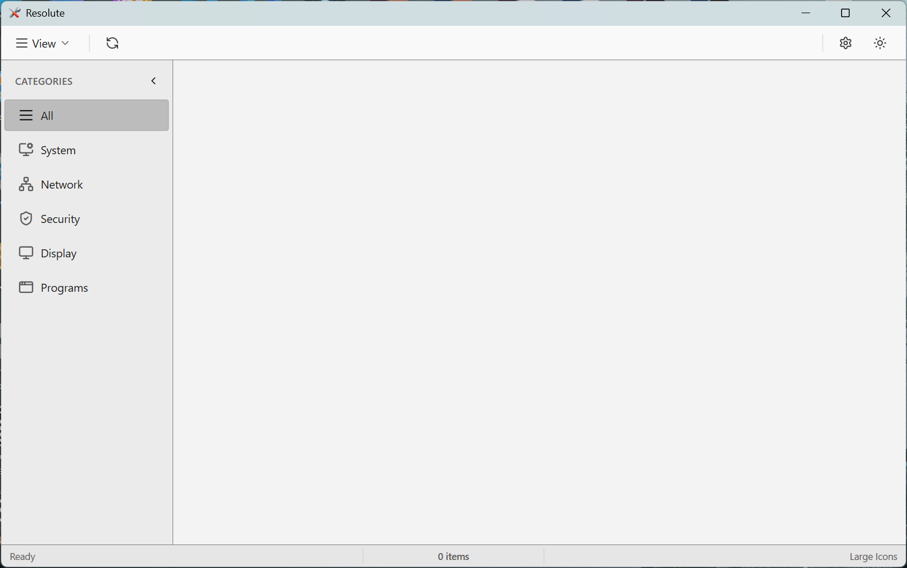
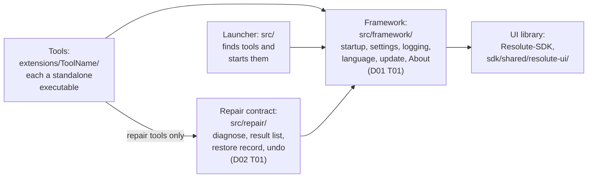

<div align="center">

<picture>
  <source media="(prefers-color-scheme: dark)" srcset="resources/logos/rizonesoft-logo-light.svg">
  
</picture>


# Resolute

**Windows repair and system tools that fix the problem, show what they changed, and can put it back.**

[](https://github.com/rizonesoft/Resolute/actions/workflows/gates.yml) [](https://github.com/rizonesoft/Resolute/actions/workflows/plan.yml) [](https://github.com/rizonesoft/Resolute/actions/workflows/quick-start.yml) [](LICENSE)  

</div>

Resolute is Rizonesoft's suite of Windows system utilities: a launcher and a set of repair and maintenance tools, each of which also ships on its own. It is being rewritten in C++ from a mature AutoIt suite that still ships, so that every tool shares one framework, scales to any display, follows the system's light or dark theme, and records what it changes so it can undo it.

<details>
<summary><b>Contents</b></summary>

- [Who is it for?](#who-is-it-for)
- [What does it look like?](#what-does-it-look-like)
- [Quick start](#quick-start)
- [Configuration](#configuration)
- [Usage](#usage)
- [The tools](#the-tools)
- [How far along is it?](#how-far-along-is-it)
- [How is it built?](#how-is-it-built)
- [Troubleshooting](#troubleshooting)
- [Docs and contributing](#docs-and-contributing)
- [Support and security](#support-and-security)
- [Status and license](#status-and-license)

</details>

## Who is it for?

People who look after Windows machines, their own or other people's, and want a tool that fixes a broken network stack, a drive Windows no longer sees or a file they cannot open, without guessing what it did. And contributors who want to build Windows tools in modern C++ against one shared framework rather than fourteen copies of one.

## What does it look like?

The launcher, built from this repository and captured with its provenance (what was captured, from which build, on which machine): [details view](docs/captures/2026-11-13-D00-T05-s1-launcher-details-light.txt) and [large icons](docs/captures/2026-11-13-D00-T05-s1-launcher-large-icons-light.txt).

<picture>
  <source media="(prefers-color-scheme: dark)" srcset="docs/captures/2026-11-13-D00-T05-s1-launcher-details-dark.png">
  
</picture>

<picture>
  <source media="(prefers-color-scheme: dark)" srcset="docs/captures/2026-11-13-D00-T05-s1-launcher-large-icons-dark.png">
  
</picture>

## Quick start

On Windows 10 or 11 x64 with Git and PowerShell 7, from an empty folder:

```powershell
git clone https://github.com/rizonesoft/Resolute.git
cd Resolute
pwsh scripts/bootstrap.ps1     # fetches the pinned Resolute-SDK into sdk/, then its pinned llvm-mingw, CMake, Ninja, Python and sccache, hash-checked
pwsh scripts/build.ps1 -All    # builds the launcher and every C++ tool, Release
pwsh scripts/check-all.ps1     # runs every gate: build, clang-tidy, tests, plan and document checks
```

Nothing is installed system-wide and no Visual Studio is needed: llvm-mingw carries its own headers and import libraries. `check-all` prints one line per gate and ends with its verdict, `check-all: <n> gate(s) ok` when every gate passed. These five lines are run exactly as written, from an empty folder with nothing cached, on every push: the `quick-start` badge above is that run.

## Configuration

Every setting is a script parameter; there is no configuration file to write.

| Setting | Default | What it does |
| --- | --- | --- |
| `bootstrap.ps1 -Force` | off | Downloads every pinned component again, even one already present |
| `bootstrap.ps1 -Replace` | off | Replaces a component whose installed version differs from its pin |
| `build.ps1 <Name>` | none | Builds one target: `Resolute` (the launcher). The tools are built in their own repositories |
| `build.ps1 -All` | none | Builds everything this repository holds, which is the launcher |
| `build.ps1 -Config` | `Release` | `Debug` or `Release` |
| `build.ps1 -ResetMovedTrees` | off | Deletes the build trees that a clone at another path made, and builds nothing. It is the cleanup alone, not a preview: an ordinary build does the same cleanup first and then builds. `pwsh scripts/build.ps1 -ResetMovedTrees` |
| `check-all.ps1 -SkipBuild` | off | Skips the build and tidy gates, for a change to documents only |

The shared UI library, the build rules and the toolchain come from [Resolute-SDK](https://github.com/rizonesoft/Resolute-SDK), at the commit [`sdk.json`](sdk.json) pins. The toolchain's pinned versions and their hashes live in the SDK's `toolchain.json`; a download whose hash differs is refused.

## Usage

`build.ps1` puts the launcher at `Bin\Release\Resolute.exe` (`Bin\Debug\` for a Debug build). Start the launcher:

```powershell
.\Bin\Release\Resolute.exe
```

The launcher lists every executable in its `System\` folder that describes itself with an embedded `RESEXT` resource ([`docs/extensions.md`](docs/extensions.md)): no install step, no registry, no configuration file. Today its list is empty: since November 2026 every tool is developed in its own repository and is copied into `System\` only when a distribution is built, and none has shipped in C++ yet, so the AutoIt tools ship from the AutoIt suite until their ports land. Each tool also runs on its own, without the launcher.

## The tools

<!-- tool-gallery:begin -->
<!-- generated by scripts/readme-blocks.py; edit docs/readme/tools.json or the plan, never this block -->
| | Tool | What it does |
| :-: | --- | --- |
|  | **Activation Diagnostics** | Is Windows activated, and what does that error code mean. |
|  | **Adapter Manager** | See your network adapters and choose which one Windows prefers. |
|  | **Attribute Repair** | Bring back files that a USB virus hid. |
|  | **Audio Devices** | Choose where sound goes, bring back hidden devices, and fix no sound. |
|  | **Battery Health** | How worn is your battery? A plain answer. |
|  | **BiosCodes** | What your computer's beeps are telling you. |
|  | **BitLocker Status** | Are your drives encrypted, and do you still have the key. |
|  | **Boot Manager** | Change the Windows boot menu, with a way back if it goes wrong. |
|  | **Boot Options** | Start in safe mode next time, and get back out again. |
|  | **Boot Time Analyzer** | How long your PC takes to start, and what is slowing it down. |
|  | **Certificate Manager** | Find the certificates that break secure websites. |
|  | **Change Journal** | Your PC was fine last week. See what changed. |
|  | **Color Profiles** | See which colour profile each display uses, and put the right one back. |
|  | **ComIntRep** | Repair your internet connection in one pass, and put it back. |
|  | **Complete Windows Repair** | Windows repairs that check their own work and can be undone. |
|  | **Connection Viewer** | See what your PC is connected to, and which program is doing it. |
|  | **Crash Decoder** | Find out what crashed your PC. |
|  | **Credential Viewer** | See which sign-ins Windows has saved, with every secret kept hidden. |
|  | **Default Apps Repair** | When a link or a file opens the wrong thing, or nothing. |
|  | **Defender Manager** | See what your security software is doing, and what it has been told to ignore. |
|  | **Disk Health** | Is your drive healthy? A plain answer. |
|  | **Display Info** | Everything about your monitors, in plain words. |
|  | **DNS Selector** | Find the fastest DNS server from where you are, and switch to it. |
|  | **Drive Repair** | Bring back a USB or DVD drive that Windows stopped showing. |
|  | **Driver Manager** | Back up your drivers and roll one back. It never updates them. |
|  | **Environment Editor** | Edit PATH and the other environment variables without breaking them. |
|  | **Erase Verification** | Check that erased really means gone. |
|  | **Explorer Performance** | Find out why File Explorer is slow. |
|  | **File Association Repair** | When files stop opening, put the right program back. |
|  | **File Unlocker** | See what is holding a file open, then let it go. |
|  | **Firemin** | Keep your browser's memory use small while it runs. |
|  | **Firewall Rules** | See every firewall rule, and the ones that should not be there. |
|  | **Hash Verifier** | Check that a download is exactly the file its publisher made. |
|  | **Hosts Editor** | Edit the hosts file without breaking it. |
|  | **Icon Cache Repair** | Fix blank, wrong and outdated icons. |
|  | **Indicators** | See your lock keys at a glance. |
|  | **Link Manager** | Make and inspect junctions, symbolic links and hard links without the command line. |
|  | **Locale Fixer** | Fix garbled text in older programs. |
|  | **Long Path Enabler** | Turn on long paths in Windows, and find out which programs can use them. |
|  | **MemBoost** | Free up memory, and see what each trim gave back. |
|  | **Ownership** | Take ownership from the right-click menu, and put it back. |
|  | **Page File Manager** | See where the Windows page file lives and how big it is, and change it safely. |
|  | **Pending Reboot Inspector** | Is Windows waiting for a restart, and what asked for it. |
|  | **Permissions Copier** | Copy the permissions of one folder onto another, and see the change first. |
|  | **PixRepair** | Wake up a stuck pixel with fast colour patterns. |
|  | **Policy Inspector** | Find out why a Windows setting is locked. |
|  | **Power Plans** | Power plans, and the power settings Windows hides. |
|  | **Printer Manager** | Printers, queues and drivers in one place, and a fix for the queue that will not clear. |
|  | **Privacy Settings** | Every Windows privacy setting in one place, with what each change costs. |
|  | **Profile Manager** | See every user profile on this PC and remove one properly. |
|  | **Proxy Inspector** | See every proxy and VPN setting on this PC, and where each one comes from. |
|  | **QuickErase** | Erase files for good, and know what that means on your drive. |
|  | **Recovery Manager** | Make sure Windows can repair itself, before you need it to. |
|  | **RegStudio** | A registry editor that shows what you changed and can put it back. |
|  | **Repair History** | Every repair made on this PC, and a way to undo each one. |
|  | **Rescue Imaging** | Copy a failing drive while it can still be read. |
|  | **Resource History** | What was slowing your PC down an hour ago. |
|  | **Restore Point Manager** | Make a restore point, and know what it covers. |
|  | **SaveDesk** | Save where your desktop icons are, and put them back. |
|  | **Scheduled Tasks** | Every scheduled task on this PC, readable, editable, and undoable. |
|  | **Search Manager** | Find out why Windows search cannot find your file. |
|  | **Security Status** | Is this PC protected? One plain report. |
|  | **Shadow Browser** | Bring back an earlier version of a file from the copies Windows keeps. |
|  | **Share Diagnostics** | Find out why a shared folder will not open. |
|  | **Shell Bisector** | Find the add-on that keeps crashing File Explorer. |
|  | **Sleep and Wake Diagnostics** | Why your PC will not sleep, and what keeps waking it. |
|  | **Software Inventory** | Everything installed on this PC, with its version, publisher, size and date. |
|  | **Startup Manager** | See everything that starts by itself, and switch off what you do not want. |
|  | **System Report** | Everything a helper needs to know about your PC, in one file you have read first. |
|  | **Undelete** | Get deleted files back, without touching the drive they were on. |
|  | **Update Blocker** | Stop one Windows update, and have it stay stopped. |
|  | **Update History** | See every Windows update that was installed, and remove one that broke something. |
|  | **USB History** | Every USB device this PC has ever seen, and when. |
|  | **UUIDGen** | Make UUIDs in the version and format you need. |
|  | **Why Is This Denied** | Find out exactly why Windows says access denied. |
|  | **Wi-Fi Diagnostics** | See your saved Wi-Fi networks and find out why the connection is poor. |
|  | **WinClean** | Clean out what Windows left behind, and see how much first. |
|  | **Windows Disk Space** | Why is Windows itself using so much space. |
|  | **Windows Features** | Turn optional parts of Windows on and off, and see it actually happening. |

Each of these 79 tools is developed and released from its own repository, on the shared code of [Resolute-SDK](https://github.com/rizonesoft/Resolute-SDK), and is bundled with the launcher when a distribution is built.
<!-- tool-gallery:end -->

## How far along is it?

<!-- plan-progress:begin -->
<!-- generated by scripts/readme-blocks.py; edit docs/readme/tools.json or the plan, never this block -->
**97 of 170 sections done** (57 percent), read from [the plan](todo/implementation-plan.md).

| Phase | Done | Of |
| --- | :-: | :-: |
| 0. Gates, proof, and the bar | 90 | 100 |
| 1. The two shared layers | 7 | 33 |
| 2. The launcher and the ports | 0 | 13 |
| 3. Intake and new capability | 0 | 0 |
| 4. Ship it, in every language | 0 | 24 |

Next to run: phase 0, Gates, proof, and the bar.
<!-- plan-progress:end -->

The plan is the contract: every section is built, proven by a check from a real run, reviewed independently and only then marked done. [`todo/README.md`](todo/README.md) explains how to read it.

## How is it built?

Every tool consumes the framework, and the repair tools also consume the repair contract. The one rule between the layers is that a tool never reimplements what a layer below it provides.



The repair contract is for the repair tools only. The UI library draws every control and owns theming, DPI scaling and typography. The framework and the repair contract are planned in [`D01 T01`](todo/01-framework/TODO-01-framework-core.md) and [`D02 T01`](todo/02-repair-contract/TODO-01-repair-contract.md); the UI library and the launcher exist today.

<details>
<summary><b>Repository layout</b></summary>

| Path | What is there |
| --- | --- |
| `src/` | The launcher shell, and nothing else |
| `sdk/shared/resolute-ui/` | The Direct2D UI library every tool draws with. Part of [Resolute-SDK](https://github.com/rizonesoft/Resolute-SDK), fetched at the commit `sdk.json` pins and not tracked here |
| `sdk/shared/lucide/` | The icon set, linked into each executable. Part of the SDK |
| `extensions/` | The tools, each building as its own standalone executable |
| `tests/` | The Catch2 suites, fixtures and the parity driver |
| `sdk/reskit/` | The downloaded toolchain and its environment helpers. Part of the SDK |
| `scripts/` | Bootstrap, build, the gates and the plan tooling |
| `resources/` | Application icons and the Rizonesoft logos |
| `resolute_au3/` | The AutoIt suite: frozen, and the specification the port is measured against |
| `todo/` | The plan; [`todo/implementation-plan.md`](todo/implementation-plan.md) is the generated view |
| `docs/` | Captures, reviews, run records and design notes |

</details>

<details>
<summary><b>What the gates check</b></summary>

`scripts/check-all.ps1` runs them all, and the `gates` workflow runs it on every push: the Debug and Release builds with warnings as errors, a clang-tidy ratchet that only goes down, the Catch2 suites in both configurations, the plan's structure and the claims it makes about this tree, the review wiring, this README's generated blocks and links, and the committed reference-data exports ([`docs/reference-data.md`](docs/reference-data.md)).

</details>

## Troubleshooting

| What you see | Why, and what to do |
| --- | --- |
| `pwsh` is not recognised | The scripts need PowerShell 7. Install it from Microsoft and run them from `pwsh`, not Windows PowerShell 5. |
| bootstrap refuses a download because its hash differs | The file is not the one pinned in the SDK's `toolchain.json`, so that component was not installed. Components bootstrap had already installed before it stay installed. Run bootstrap again: it skips what is present at its pinned version and retries the rest. If the refusal persists, the mirror changed and the pin needs review. |
| CMake complains that the build tree was made at another path | `build.ps1` removes and rebuilds a tree another clone made; run it again rather than `cmake` by hand. |
| the launcher's list is empty | Expected today: no tool declares itself to the launcher yet (`D05 T02 §1`). Start a tool directly from `Bin\<Config>\System\`. |
| a gate fails in `check-all` | Its log is under `build\logs\`, named after the gate; the last lines name the failure. |

## Docs and contributing

- [`AGENTS.md`](AGENTS.md): the contract for anyone, human or agent, changing this tree. Review runs through one pinned reviewer, configured in `.conclave/reviewers.toml` and run by `scripts/review-dispatch.py`.
- [`DESIGN.md`](DESIGN.md): the design contract every surface answers to.
- [`todo/README.md`](todo/README.md): how the plan is written and read.
- [`CONTRIBUTING.md`](CONTRIBUTING.md): how to propose a change and what proof it owes.

## Support and security

Questions and bugs go to [GitHub issues](https://github.com/rizonesoft/Resolute/issues), using the bug or feature template. Report a vulnerability privately as [`SECURITY.md`](SECURITY.md) describes, never in a public issue. The changelog arrives with the first C++ release, owned by `D06 T01 §6`.

## Status and license

The AutoIt suite is the one in use today, and the C++ suite replaces it tool by tool as the plan above says.

Resolute is licensed under the GNU General Public License, version 3: see [`LICENSE`](LICENSE). Each tool carries the same licence in its own repository. The shared [Resolute-SDK](https://github.com/rizonesoft/Resolute-SDK) is MIT, and the Lucide icons it carries are ISC.

Each tool is moving to its own repository, and this one becomes the launcher: [`docs/plans/2026-11-15-app-split.md`](docs/plans/2026-11-15-app-split.md) tracks the move. A tool still listed above and found in this tree is one the move has not reached yet.
